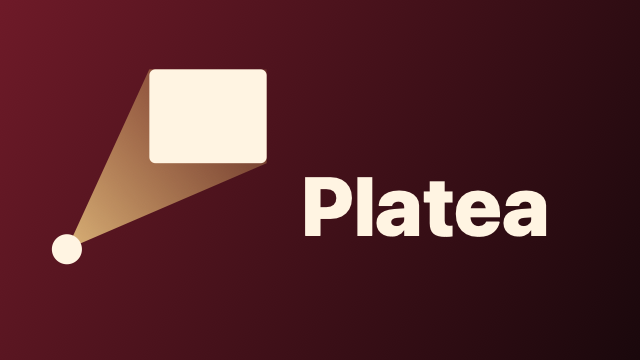
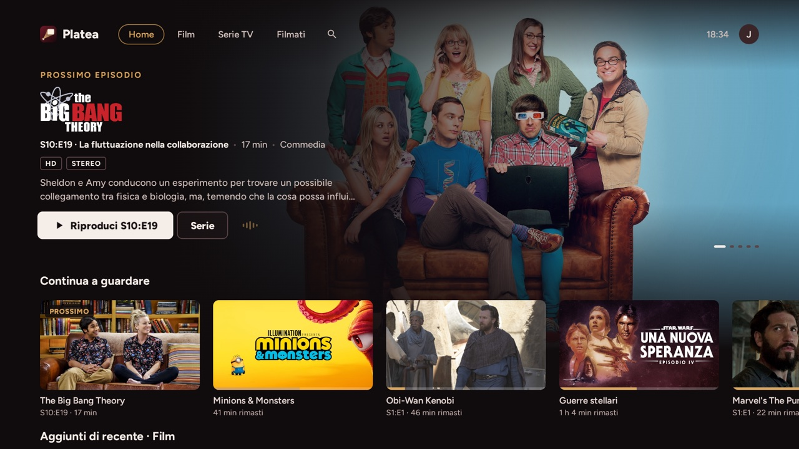
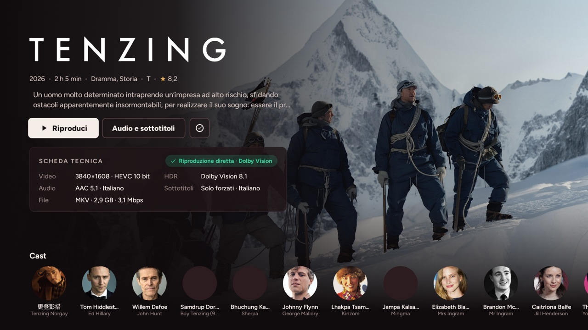
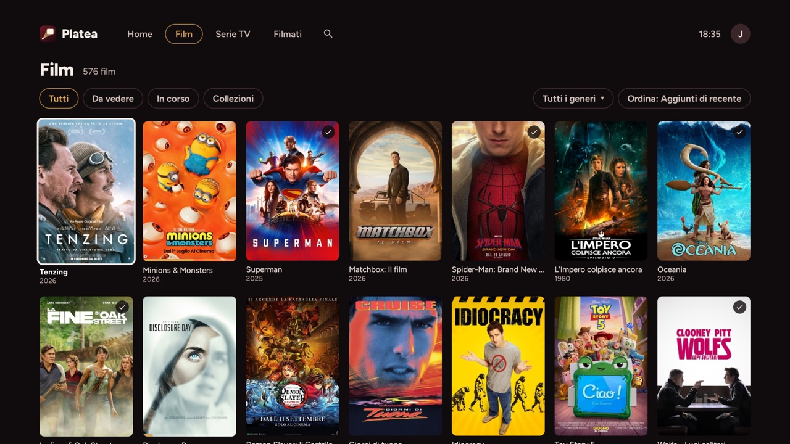
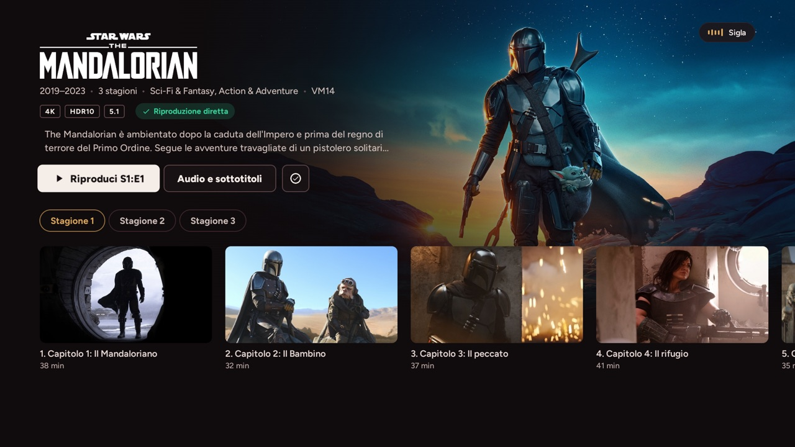

# Platea 🎬


**Platea is a Jellyfin client for Android TV, Google TV and Fire TV, made for a curated 4K library: reliable direct play, real Dolby Vision, correct HDR10+ and HDR10, audio passthrough and subtitles done right.**

<p align="center"></p>

<p align="center"></p>

<table>
  <tr>
    <td></td>
    <td></td>
  </tr>
  <tr>
    <td></td>
    <td></td>
  </tr>
</table>

> Platea is a fork of [Wholphin](https://github.com/damontecres/Wholphin) 1.0.8 by damontecres, licensed under the GNU GPL v2, and has been developed independently since October 2026.
> It was developed with the help of AI and is not affiliated with or endorsed by the author of Wholphin or by the Jellyfin project.
> Please do not report issues of Platea to the original project.

## ✨ Features

- **Direct play first**: a device profile built from what the TV can really decode and show, so the server sends the file as it is. Conversion by the server is an explicit, logged fallback that can be switched off.
- **Real Dolby Vision, HDR10+ and HDR10**, with a notice when a Dolby Vision file ends up on a decoder without it.
- **Audio passthrough** (AC3, E-AC3, Atmos, DTS where the TV supports it); TrueHD and DTS decoded by the app when the TV cannot take them.
- **Smooth 24p**: refresh rate switching before playback, and tunneled playback on TVs that only offer 60 Hz to Android.
- **Subtitles**: PGS and ASS rendered by the app, forced-only by default, full subtitles when the audio is in another language, track choices remembered per title and per series.
- **Direct reading from the NAS** (optional, like Infuse): in direct play the file is read from the SMB share instead of going through the Jellyfin server, with a fallback to the server stream.
- **Its own interface** in the "velvet and gold" design: home with a featured title, libraries, movie and series pages, collections, people, search with voice input, player with chapters, seek bar previews (trickplay), skip intro and next episode, built-in diagnostics, profiles with PIN, screensaver.
- **Theme songs** of the series from Jellyfin, which keep playing from the home to the series page.
- **Automatic updates** from the GitHub releases, with a prompt on the home.
- **Playback journal**: how every title was served and how long it took to start, kept on the device.
- English and Italian.

## 🚀 Requirements

- Android TV / Google TV 6.0 or later, or Fire TV (Fire OS 7 or later)
- A Jellyfin server, 10.11 or later (used with 12.4)
- Tested on: Amazon Fire TV Stick 4K Max (2nd gen.), Sony BRAVIA (Android TV 12); TCL Google TV planned

## 📥 Installation

1. Download the APK of the [latest release](https://github.com/Gionnio/platea/releases/latest): `arm64-v8a` for most recent TVs, `armeabi-v7a` for the Fire TV Stick and older 32-bit TVs, or the universal APK if unsure.
2. Install it with an app like *Downloader*, or from a computer with ADB:
   ```bash
   adb connect <tv-ip>:5555
   adb install Platea-release-<version>-arm64-v8a.apk
   ```
   ADB needs **Developer options** and **ADB debugging** on the TV (Fire TV: Settings → My Fire TV → Developer options; Google TV: Settings → System → About → press *Android TV OS build* 7 times).
3. Open Platea, choose your server (servers on your network are found automatically) and sign in, with your password or Quick Connect.

After that Platea updates itself: when a new release is out it asks on the home whether to install it. The first time Android asks to allow Platea to install apps; Fire TV also asks to confirm every update.

## 🛠 Build from Source

Requirements: JDK 17, Android SDK (platform 37, build-tools 37).

```bash
brew install --cask corretto@17 android-commandlinetools android-platform-tools
sdkmanager "platforms;android-37.0" "build-tools;37.0.0" "platform-tools"
echo "sdk.dir=/opt/homebrew/share/android-commandlinetools" > local.properties
./gradlew assembleDebug
```

The APK is written to `app/build/outputs/apk/debug/`. `./gradlew testDebugUnitTest` runs the tests.

The FFmpeg audio decoder (TrueHD, DTS) is not in the repository: `scripts/build-ffmpeg-decoder.sh` builds it from the sources of [Media3](https://github.com/androidx/media) and [FFmpeg](https://ffmpeg.org) 6.0 (LGPL build) into `app/libs/`, and the app picks it up. Without it Platea builds and works, and leaves those formats to the TV or to the server.

The release build is signed with a key outside the repository (`PlateaReleaseStoreFile`, `PlateaReleaseStorePassword`, `PlateaReleaseKeyAlias` in `~/.gradle/gradle.properties`); `scripts/publish-update.sh` publishes it as a GitHub release for the automatic updates.

## 🚧 Roadmap & TODO

- [x] Own identity, icon and TV banner
- [x] Device capabilities and complete device profile (no more needless remux)
- [x] Real Dolby Vision, HDR10+, HDR10; passthrough; forced-only subtitles; client-side PGS and ASS
- [x] Own interface; inherited screens and unused features removed
- [x] TrueHD and DTS decoded by the app, smooth 24p on 60 Hz TVs, seek bar previews
- [x] Direct reading from the NAS
- [x] Automatic updates
- [ ] Verification on TCL Google TV

## Privacy & Security

- No analytics, no telemetry, no crash reporting, no account other than your Jellyfin server.
- Platea talks to your Jellyfin server and, if you turn it on, to your NAS. The only other host it contacts is **GitHub**, to look for updates when the home opens (at most every 6 hours); this can be switched off in Settings → Updates.
- The NAS password is stored encrypted with a key of the Android keystore and never leaves the device.
- Updates are checked before installing: size and SHA-256 of the APK, and Android itself refuses an APK signed with a different key.

## 🤖 AI Acknowledgment

This application was developed with the assistance of Artificial Intelligence. AI tools helped analyze the original codebase, write code and documentation, and design the icon, under my direction and review.

## License & Credits

Platea is free software under the **GNU General Public License v2.0** (see `LICENSE`), as required by the original project. The full list of libraries and their licenses is in the app, under Settings → Advanced settings → System → Licenses.

- Based on [Wholphin](https://github.com/damontecres/Wholphin) by damontecres and its contributors.
- Parts of the device profile code come from [jellyfin-androidtv](https://github.com/jellyfin/jellyfin-androidtv) (GPL-2.0); the files say which.
- Playback with [AndroidX Media3](https://github.com/androidx/media) (Apache 2.0); TrueHD and DTS with [FFmpeg](https://ffmpeg.org) (LGPL 2.1); ASS subtitles with [libass](https://github.com/libass/libass) through [libass-android](https://github.com/peerless2012/libass-android); NAS access with [smbj](https://github.com/hierynomus/smbj) (Apache 2.0).
- Interface font: [Figtree](https://github.com/erikdkennedy/figtree) by Erik Kennedy, SIL Open Font License 1.1.

Created with AI, ❤️ and Kotlin.
